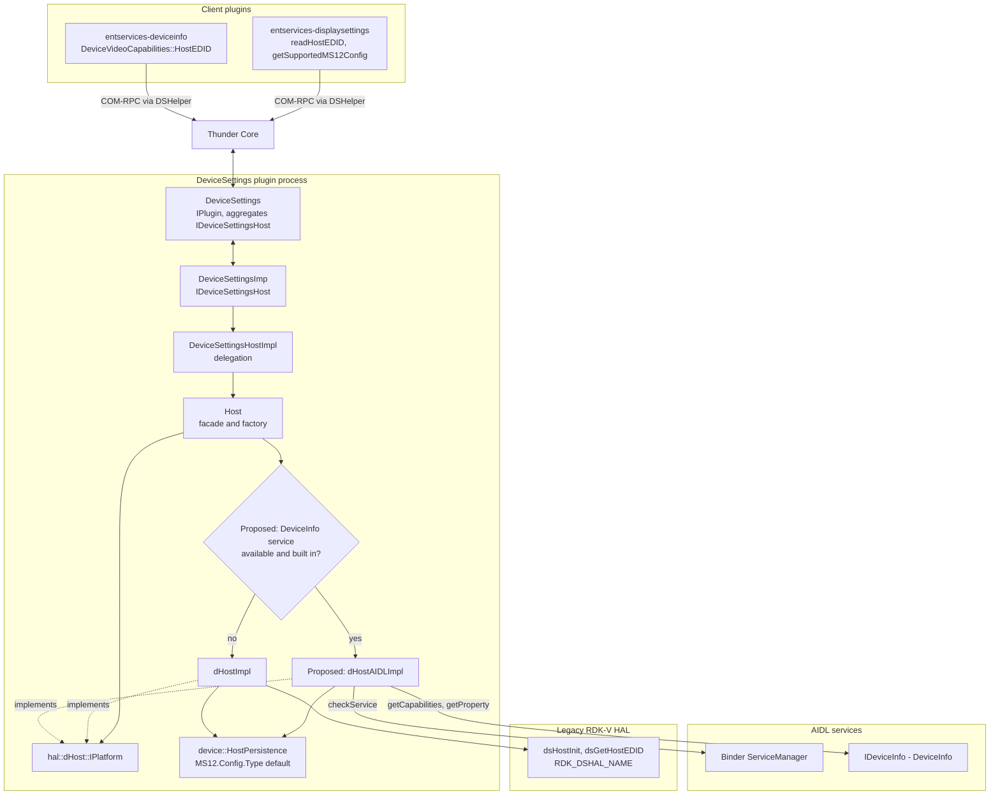
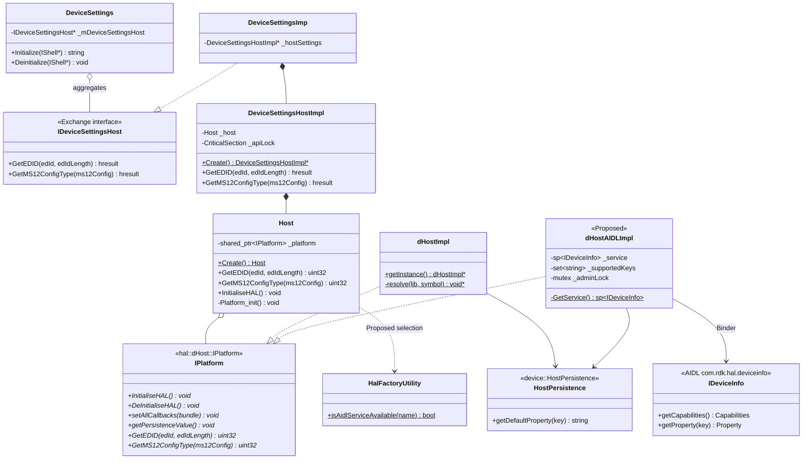
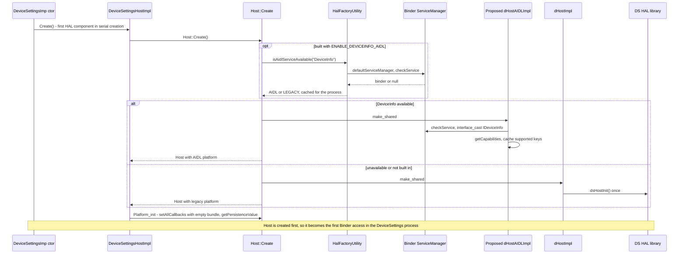
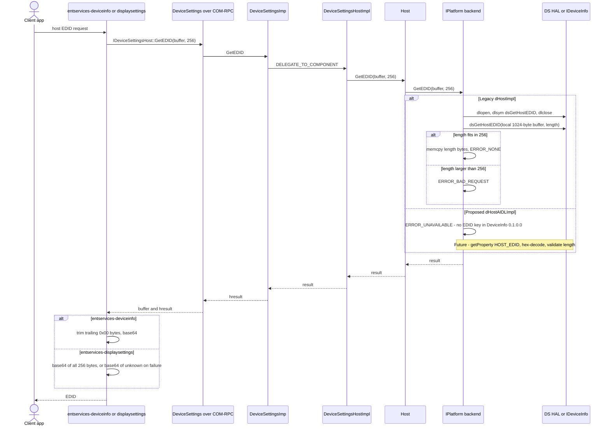
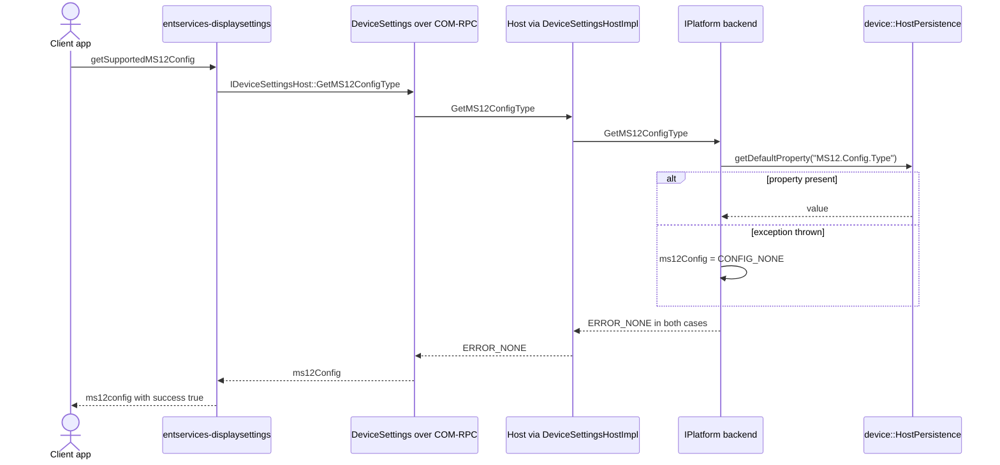

# DeviceSettings Host (DS-Host) — Architecture and AIDL HAL Integration

| | |
| --- | --- |
| **Component** | Host — `entservices-devicesettings/plugin/Host.*`, `plugin/hal/dHost*.h`, `DeviceSettingsHostImplementation.*` |
| **Server type** | DeviceSettings component, aggregated by the `DeviceSettings` Thunder plugin (startup order 15). Not a separate plugin. |
| **Exchange interface** | `Exchange::IDeviceSettingsHost` — `GetEDID`, `GetMS12ConfigType`; no notifications |
| **AIDL HAL** | `com.rdk.hal.deviceinfo` — `IDeviceInfo`, service name `"DeviceInfo"`, interface version `0.1.0.0` (frozen; `current` is identical) |
| **Target** | vdevice first; the design must hold for all devices and platforms |
| **Status** | Architecture and gap analysis. **Implementation not started.** Items marked *Proposed* are design targets, not existing code. |
| **Verified against** | Source snapshot under `Documentation/` (entservices-devicesettings, entservices-deviceinfo, entservices-displaysettings, rdk-halif-aidl, entservices-powermanager) on 22 Oct 2026 |
| **Diagrams** | Mermaid. On Confluence, render with the Mermaid macro. |

---

## 1. Purpose

Host is a DeviceSettings component that exposes host-level platform data through `Exchange::IDeviceSettingsHost`. Like VideoPort, VideoDevice, CompositeIn and HDMIIn, it is aggregated by the DeviceSettings Thunder plugin rather than deployed as an independent plugin. The interface has two methods and no notifications:

| Method | Meaning |
| --- | --- |
| `GetEDID(uint8_t edId[], uint16_t edIdLength)` | EDID bytes that identify the host device itself (not the connected sink) |
| `GetMS12ConfigType(string& ms12Config)` | The platform's Dolby MS12 configuration type |

### Supported backends

| Backend | Binding |
| --- | --- |
| **Legacy DS HAL** (`dHostImpl`) | `dsHostInit()` (linked at build time) at construction. `dsGetHostEDID` resolved from `RDK_DSHAL_NAME` with `dlsym` on every call. The MS12 config type is read from `device::HostPersistence` default property `MS12.Config.Type`. |
| **AIDL HAL** (*Proposed* `dHostAIDLImpl`) | `com.rdk.hal.deviceinfo.IDeviceInfo` (`"DeviceInfo"`), selected at runtime in the same way as the other AIDL-enabled DeviceSettings components |

### Main purpose of this document

This document defines the AIDL backend structure for Host and how it is selected. It also records the central finding of the gap analysis: **DeviceInfo `0.1.0.0` currently provides data for neither Host operation.**

1. **`Property` has no value field** (key, type, sizeInBytes and zeroTerminated only), so `getProperty()` cannot return data. This blocker is shared with MFR Manager.
2. **No DeviceInfo key carries an EDID.** None of the 15 HFP keys (`HAL_VERSION`, `MANUFACTURER`, `MANUFACTURER_OUI`, `MODEL_NAME`, `PRODUCT_CLASS`, `SERIAL_NUMBER`, `WIFI_MAC`, `BLUETOOTH_MAC`, `WPS_PIN`, `ETHERNET_MAC`, `RF4CE_MAC`, `COUNTRY_CODE`, `LANGUAGE_CODE`, `DEVICE_TYPE`, `CHIPSET_ID`) is a host EDID.
3. **The MS12 config type is not a HAL value on either backend.** It comes from the platform persistence defaults and is backend-independent.

**Consequence:** an AIDL Host backend would serve less than the legacy backend today. The recommendation (§16) is to land the structural refactor now and enable AIDL selection only after the contract changes land.

### Scope

| In scope | Out of scope |
| --- | --- |
| The Host component, its backend selection, lifecycle, build integration and clients (`entservices-deviceinfo`, `entservices-displaysettings`) | Changes to the `IDeviceSettingsHost` API (listed as gaps). DeviceSettings-wide `HalFactoryUtility` changes (flagged as a dependency). Other DeviceSettings components. |

---

## 2. System Architecture

End-to-end path: client app → JSON-RPC → client plugin → COM-RPC (`DSHelper::AcquireSubInterface<IDeviceSettingsHost>`) → DeviceSettings → `DeviceSettingsImp` → `DeviceSettingsHostImpl` → `Host` → selected `IPlatform` backend → HAL.

**Client inventory (verified).** Only `entservices-deviceinfo` and `entservices-displaysettings` use `IDeviceSettingsHost`. `entservices-displayinfo` reads the **sink** EDID through `IDeviceSettingsDisplay`, not the host EDID. `entservices-avinput`, `entservices-avoutput`, `entservices-hdcpprofile` and `entservices-framerate` have no Host dependency.

---

## 3. Component Responsibilities

| Component | Status | Responsibility |
| --- | --- | --- |
| `DeviceSettings` | Existing | Manages the Thunder lifecycle and obtains `IDeviceSettingsHost` with `QueryInterface` for external COM-RPC access. Registers no Host notification sink, because the interface defines none. |
| `DeviceSettingsImp` | Existing | Implements `Exchange::IDeviceSettingsHost`. Creates `DeviceSettingsHostImpl` **first** in the serial component creation, timed by the `[DS-INIT-TIMING] Host::Create` log line. Delegates with `DELEGATE_TO_COMPONENT`. |
| `DeviceSettingsHostImpl` | Existing | Owns the `Host` facade and logs results. Holds an `_apiLock` that is currently unused. |
| `Host` | Existing; *Proposed* change | Backend-independent API. Today `Host::Create()` always constructs `dHostImpl`. *Proposed:* select the AIDL or legacy backend, and call `InitialiseHAL()` through `platform()`. |
| `hal::dHost::IPlatform` | Existing; *Proposed* change | Contract: `setAllCallbacks`, `getPersistenceValue`, `GetEDID`, `GetMS12ConfigType`. `InitialiseHAL`/`DeInitialiseHAL` are declared non-virtual and never defined. *Proposed:* make them pure virtual, as in `dVideoPort`, `dVideoDevice`, `dCompositeIn` and `dHdmiIn`. |
| `dHostImpl` | Existing | Legacy mapping: `dsHostInit()` once (static flag); `dsGetHostEDID` through `dlsym` into a 1024-byte local buffer; `HostPersistence` for MS12. |
| `dHostAIDLImpl` | *Proposed* | Acquires `IDeviceInfo` and caches its capabilities. `GetEDID` returns `ERROR_UNAVAILABLE` until a host EDID key exists. `GetMS12ConfigType` uses a shared `HostPersistence` helper. |
| `HalFactoryUtility` | Existing | Caches AIDL availability per service name (`checkService`) for the life of the process. |
| `IDeviceInfo` (vendor, OEM-owned) | Existing contract | Read-only persisted properties. No listeners and no state. |
| `entservices-deviceinfo` — `DeviceVideoCapabilities::HostEDID` | Existing client | Calls `GetEDID` with a 256-byte buffer, trims trailing `0x00` bytes and base64-encodes the rest. Returns the error to the caller on failure. |
| `entservices-displaysettings` — `readHostEDID`, `getSupportedMS12Config` | Existing client | `readHostEDID` calls `GetEDID` with a 256-byte buffer and base64-encodes **all 256 bytes**. On failure it returns base64 of `"unknown"` with `success: true`. `getSupportedMS12Config` returns `ms12config`. |

---

## 4. Public Operations

### 4.1 Operations and backend mapping

| Exchange operation | Facade operation | Legacy mapping | AIDL mapping | Client usage |
| --- | --- | --- | --- | --- |
| `GetEDID` | `Host::GetEDID` | `dlsym dsGetHostEDID(local[1024], &length)`. Copies the data if `length ≤ edIdLength`, otherwise returns `ERROR_BAD_REQUEST`. Missing symbol → `ERROR_UNAVAILABLE`; HAL error → `ERROR_GENERAL`. | **No equivalent in DeviceInfo `0.1.0.0`.** Interim: `ERROR_UNAVAILABLE`. Future (Option 1, §15): `getProperty("HOST_EDID")`, hex-decode, validate. | DeviceInfo `HostEDID()`; DisplaySettings `readHostEDID` |
| `GetMS12ConfigType` | `Host::GetMS12ConfigType` | `HostPersistence::getDefaultProperty("MS12.Config.Type")`. On exception it returns `"CONFIG_NONE"` with `ERROR_NONE`. | Same persistence read (backend-independent). DeviceInfo has no matching key. The audiomixer MS12 profile list (`OutputPortCapabilities`) is a different concept and does not replace it. | DisplaySettings `getSupportedMS12Config` |
| Lifecycle: `InitialiseHAL` | `Host::InitialiseHAL` | `dsHostInit()` once, guarded by a static flag | `checkService` plus `getCapabilities` | — |
| Lifecycle: `DeInitialiseHAL` | — | Clears the flag only; `dsHostTerm()` is never called | Releases the proxy | — |

### 4.2 Candidate AIDL sources for the host EDID

| Source | Verified behaviour | Fit |
| --- | --- | --- |
| `com.rdk.hal.deviceinfo` | No EDID key; `Property` has no value | Needs a new OEM key plus the value-field fix |
| `com.rdk.hal.hdmiinput` — `IHDMIInput::getEDID` | Returns the EDID set on an HDMI **input** port, or a default EDID if none has been set | TV profile only. It is per port and can be changed with `setEDID`, so it is not a fixed host identity. |
| `com.rdk.hal.hdmioutput` — `IHDMIOutputControllerListener::onEDID` | Reports the **sink** EDID read over HDMI output | Not the host EDID |

---

## 5. Event Mapping

| Exchange notification | AIDL source | Legacy source |
| --- | --- | --- |
| *(none)* — `IDeviceSettingsHost` defines no `INotification` | DeviceInfo defines no listeners | `dHostImpl::setAllCallbacks` receives an empty `CallbackBundle` |

Host has no event flows on either backend. If a host property ever becomes dynamic, both the Exchange interface and the HAL will need a notification path.

---

## 6. Class Diagram

> The `IPlatform` lifecycle methods are shown as pure virtual, which is the *Proposed* state. Today they are non-virtual and undefined, and `Host::InitialiseHAL()` reaches `dHostImpl` through `std::static_pointer_cast<dHostImpl>` (§14, #1).

---

## 7. Initialization and Backend Selection

**Selection rules and timing**

- Today `Host::Create()` is `return Host(std::make_shared<dHostImpl>());`, with no selection.
- `HalFactoryUtility` caches the decision per service name for the life of the process. There is no runtime switch.
- **No Binder pre-check.** DeviceSettings' `HalFactoryUtility` calls `defaultServiceManager()` without the Binder ping (`isServiceManagerAvailable()`) that PowerManager runs first. `ServiceManagerCheck.cpp` is compiled into DeviceSettings but never called. Because Host is created first, it would be the first component to hit this on a platform without Binder (Risk 6; the fix is DeviceSettings-wide and outside Host scope).
- **Ordering.** The DeviceInfo HAL must be registered before DeviceSettings activates (startup order 15). Otherwise legacy is selected for the life of the process (Risk 7).
- **No Binder thread pool is required for Host.** DeviceInfo has no listeners. Calling `startThreadPool()` again is harmless, because the existing AIDL adapters already call it.

---

## 8. Functional Flows

### 8.1 `GetEDID`, end to end

**Interface gap shown by this flow.** `GetEDID` does not return the actual EDID length, so the two clients handle the buffer differently:
- `entservices-deviceinfo` trims trailing zero bytes. This removes a legitimate `0x00` checksum byte, and any zero bytes before it, from a valid EDID.
- `entservices-displaysettings` returns all 256 bytes, so a 128-byte EDID carries 128 bytes of padding.

The same host EDID therefore reaches applications in two different forms (§14, #6).

### 8.2 `GetMS12ConfigType`, end to end (backend-independent)

Both backends take the same path. *Proposed:* both call one shared helper so the logic is not duplicated.

### 8.3 Event flows

None. See §5.

### 8.4 AIDL service loss (*Proposed*, applies once Host makes a functional Binder call)

On `DEAD_OBJECT`, re-acquire the service once with `checkService`, refresh the cached capabilities and retry once. Otherwise return `ERROR_UNAVAILABLE`. The backend never switches to legacy at runtime. This matches the MFR Manager rule.

---

## 9. Backend Capability Notes

| Area | AIDL backend (*Proposed* `dHostAIDLImpl`) | Legacy backend (`dHostImpl`) |
| --- | --- | --- |
| Host EDID | Not available: no key, and `Property` has no value. Returns `ERROR_UNAVAILABLE`. | `dsGetHostEDID` when the symbol is present. `ERROR_UNAVAILABLE` when it is missing; `ERROR_BAD_REQUEST` when the EDID is larger than the caller's buffer. |
| MS12 config type | `HostPersistence` (backend-independent) | `HostPersistence` |
| HAL init and term | Proxy acquisition; nothing to terminate | `dsHostInit()`; `dsHostTerm()` never called |
| Events | None | None |
| Device identity data (serial, model, MACs) | Present in DeviceInfo but not part of `IDeviceSettingsHost`; served to clients through MFR Manager | n/a |
| Build | Requires `ENABLE_DEVICEINFO_AIDL` (headers and library found) | Always built |
| Link-time dependency | DeviceInfo library, `binder`, `utils` | DS HAL library (`dsHostInit` is called directly) |

---

## 10. Threading, Ownership and Timing

- **Today.** `GetEDID` and `GetMS12ConfigType` are stateless reads. `_apiLock` is unused, and `dHostImpl` repeats `dlopen`, `dlsym` and `dlclose` on every `GetEDID` call. Concurrent calls from DeviceInfo and DisplaySettings share no Host-layer state. Whether `dsGetHostEDID` is re-entrant in the HAL was not verified.
- **Static flags.** `host_isInitialized` and `host_isPlatInitialized` are `static int` variables defined in a header. Each translation unit gets its own copy (§14, #2).
- **AIDL backend (*Proposed*).** One mutex guards the cached proxy and the key set. Copy the `sp` under the lock and make the Binder call outside it.
- **Start-up cost.** Selection adds one `checkService` round trip to `Host::Create`. It is measured by the existing `[DS-INIT-TIMING] Host::Create` log line.

---

## 11. Failure and Fallback Behaviour

| Condition | Behaviour |
| --- | --- |
| Not built with `ENABLE_DEVICEINFO_AIDL`, or `"DeviceInfo"` not published at `Host::Create` | Legacy backend for the life of the process |
| AIDL backend, `GetEDID` | `ERROR_UNAVAILABLE`. DeviceInfo returns the error; DisplaySettings returns base64 of `"unknown"` with `success: true`, which hides the failure. |
| Legacy backend, `dsGetHostEDID` missing | `ERROR_UNAVAILABLE` (same client behaviour as above) |
| EDID larger than the caller's buffer (256 for both clients) | `ERROR_BAD_REQUEST` |
| `GetMS12ConfigType` with no persisted value | `"CONFIG_NONE"` with `ERROR_NONE`. Clients cannot tell "not configured" from "configured as CONFIG_NONE". |

---

## 12. Build Integration (*Proposed*)

| Change | Detail |
| --- | --- |
| CMake detection | Mirror the HDMI Output block. Use `find_path` for `com/rdk/hal/deviceinfo/IDeviceInfo.h` (suffixes `mw/deviceinfo/0.1.0.0/include`, `vendor/deviceinfo/0.1.0.0/include`) and `find_library` for `deviceinfo-v0.1.0.0-cpp` (suffixes `mw/rdk-halif-aidl`, `vendor/rdk-halif-aidl`), plus the existing `ANDROID_BINDER_*` results. On success, add `hal/dHostAIDLImpl.cpp` and define `ENABLE_DEVICEINFO_AIDL`. DeviceInfo has no imports, so the `common` AIDL library is not required. |
| **Source guards** | Wrap the AIDL includes and the factory branch in `#ifdef ENABLE_DEVICEINFO_AIDL`. The existing `VideoPort.cpp` and `CompositeIn.cpp` include AIDL headers and reference AIDL classes unconditionally, and `ENABLE_*_AIDL` appears only in CMake. The documented "DS HAL-only build when artifacts are missing" therefore does not compile today. Host must not copy that pattern (Risk 5). |
| Lifecycle refactor | In `hal/dHost.h`, make `InitialiseHAL`/`DeInitialiseHAL` pure virtual. In `Host.h`, call `platform().InitialiseHAL()` instead of using `std::static_pointer_cast<dHostImpl>`, which is undefined behaviour once `_platform` can hold `dHostAIDLImpl`. |
| MS12 helper | Move the `HostPersistence` read into one helper that both implementations call. The `IPlatform` signature does not change. |
| DS HAL dependency | `dHostImpl` calls `dsHostInit()` directly, so the DeviceSettings implementation library has a link-time dependency on the DS HAL. AIDL-only platforms still need that library or a stub. This is a DeviceSettings-wide decision (Risk 10). |

---

## 13. Security Considerations

| Area | Consideration |
| --- | --- |
| Future EDID decode | Check that the hex string has even length and contains only `[0-9A-F]` (UPPERCASEHEX), and that the decoded size is ≤ `sizeInBytes` and ≤ `edIdLength`, before copying. Never copy part of the value. |
| Caller-controlled length | `edIdLength` is a `uint16_t` (up to 65535). The current code copies at most `length` bytes, and only when `length ≤ edIdLength`; keep that invariant. A negative `length` from the HAL is not rejected (§14, #4). |
| Data sensitivity | An EDID can embed the device serial number. The current code logs only lengths; keep it that way. |
| Access control | COM-RPC access is governed by the Thunder security token; Host adds no checks of its own. |
| Service identity | Confirm that only the vendor HAL can register `"DeviceInfo"` (shared question with MFR Manager). |

---

## 14. Pre-existing Observations (not introduced by this design; recorded for triage)

| # | Observation | Location | Impact |
| --- | --- | --- | --- |
| 1 | `Host::InitialiseHAL()` uses `std::static_pointer_cast<dHostImpl>`, and `IPlatform::InitialiseHAL` is non-virtual and never defined. | `Host.h`, `hal/dHost.h` | Undefined behaviour once a second implementation exists. **Must be fixed before AIDL.** |
| 2 | `static int host_isInitialized` and `host_isPlatInitialized` are defined in a header, and inline members in several translation units use them. | `hal/dHostImpl.h` | Each translation unit has its own flags; ODR hazard |
| 3 | `resolve()` calls `dlopen`, `dlsym`, then `dlclose`, and uses the pointer afterwards. It runs on every `GetEDID`. | `hal/dHostImpl.h` | Safe only while the link-time dependency keeps the DS HAL loaded; per-call cost |
| 4 | `length` returned by `dsGetHostEDID` is an `int` and is not checked for being negative before `memcpy(edId, edidBytes, length)`. `dsGetHostEDID` also takes no buffer-capacity input, so the 1024-byte local buffer relies on the HAL never writing more (HAL limit not verified). | `hal/dHostImpl.h` | A negative length becomes a huge `size_t` → crash; an oversized HAL write overflows the stack |
| 5 | `DeInitialiseHAL()` never calls `dsHostTerm()`, and `_apiLock` is unused. | `hal/dHostImpl.h`, `DeviceSettingsHostImplementation.h` | Resource release; dead code |
| 6 | `IDeviceSettingsHost::GetEDID` returns no length, and the clients handle the buffer differently (§8.1). | `entservices-apis`, both clients | Inconsistent EDID returned to applications |
| 7 | `GetMS12ConfigType` reports `ERROR_NONE` on failure. | `hal/dHostImpl.h` | Failure is invisible to clients |
| 8 | DeviceSettings `HalFactoryUtility` has no Binder or ServiceManager pre-check. | `HalFactoryUtility.cpp` | Possible hang or abort on platforms without Binder |
| 9 | AIDL source guards are missing in `VideoPort.cpp` and `CompositeIn.cpp`. | DeviceSettings plugin | A legacy-only build fails |

---

## 15. Design Options for the Host EDID Source

| Option | Description | Pros | Cons |
| --- | --- | --- | --- |
| **1 (recommended)** | Add an OEM key `HOST_EDID` (UPPERCASEHEX) to the DeviceInfo HFP once `Property` carries a value | Host stays on one HAL; DeviceInfo already models persisted device identity | Needs HFP and contract changes. A 256-byte EDID is 512 hex characters, and the size semantics are still undefined (MFR Manager doc, Risk 3). |
| 2 | TV profile: derive the EDID from `hdmiinput` `IHDMIInput::getEDID` (default EDID) | No contract change on TVs | Per port; changeable with `setEDID`; no STB equivalent; adds a second HAL dependency to Host |
| 3 | Hybrid: the AIDL backend falls back to `dsGetHostEDID` when the DS HAL is present | Keeps the function working on transitional platforms | Two HALs inside one backend; breaks the one-backend-per-component pattern; no help on AIDL-only platforms |
| 4 | Synthesize an EDID from DeviceInfo identity keys | No new key | **Rejected.** DeviceInfo has no PNP manufacturer ID, product code or manufacture week/year, so the result would be fabricated. |

---

## 16. Recommended Phasing

| Phase | Content | Gate |
| --- | --- | --- |
| **0 — structural (no contract dependency)** | Lifecycle refactor (pure-virtual `InitialiseHAL`/`DeInitialiseHAL`; remove `static_pointer_cast`), shared MS12 helper, CMake detection with `ENABLE_DEVICEINFO_AIDL` source guards, and a `dHostAIDLImpl` skeleton. **`Host::Create()` keeps returning `dHostImpl`.** | None |
| **1 — functional** | Implement `GetEDID` from the chosen source (§15), enable selection in `Host::Create()`, add the AIDL tests in §18 | Risks 1 and 2 closed |

Enabling selection in Phase 0 would cause a regression: on a platform that publishes DeviceInfo and still ships `dsGetHostEDID`, Host would switch to a backend that cannot return the EDID. On an AIDL-only platform, `dHostImpl` already returns `ERROR_UNAVAILABLE` for `GetEDID` because the symbol is missing. Keeping legacy in Phase 0 therefore loses nothing anywhere.

**Dependencies outside Host (flagged, not resolved here):**
- DeviceSettings-wide Binder pre-check in `HalFactoryUtility` (Risk 6).
- An output-length addition to `IDeviceSettingsHost::GetEDID` in `entservices-apis` (Risk 8).
- Aligning EDID handling in the two clients.
- Fixing the source guards in `VideoPort.cpp` and `CompositeIn.cpp`.

---

## 17. Open Questions and Decisions Required

| # | Question | Proposed baseline |
| --- | --- | --- |
| Q1 | DeviceInfo currently serves neither Host operation. Is it confirmed as the Host AIDL source, and which EDID option (§15) is chosen? | DeviceInfo with Option 1 |
| Q2 | Accept the phasing, with selection disabled until an EDID key exists? | Yes |
| Q3 | MS12 config type: shared helper with `IPlatform` unchanged, or move it into the facade? | Shared helper (smallest blast radius) |
| Q4 | Approve the DeviceSettings-wide Binder pre-check in `HalFactoryUtility`? It is outside Host scope. | Yes, as a separate change |
| Q5 | Should `IDeviceSettingsHost::GetEDID` gain an output length? This is an `entservices-apis` change. | Yes, as a separate change |
| Q6 | Does vdevice ship a DeviceInfo AIDL service and the `MS12.Config.Type` persistence default? | Confirm |

---

## 18. Proposed Test Scenarios

Types: **S** simulation, **N** negative, **E** edge, **R** regression, **Sec** security.

| ID | Type | Scenario | Expected result |
| --- | --- | --- | --- |
| S1 | S | Build without DeviceInfo artifacts | Compiles (proves the source guards); Host uses `dHostImpl` |
| S2 | S | Build with the artifacts; DeviceInfo not published | Legacy backend; `[DS-INIT-TIMING] Host::Create` within baseline |
| S3 | S | Phase 1: DeviceInfo published with `HOST_EDID` | AIDL backend; `GetEDID` bytes identical to the vendor reference |
| S4 | S | Platform without `/dev/binder` | `Host::Create` neither hangs nor aborts (depends on Q4) |
| S5 | S | Phase 1: restart the DeviceInfo HAL after selection | The next `GetEDID` recovers through a single re-acquire |
| N1 | N | Legacy with `dsGetHostEDID` missing | `ERROR_UNAVAILABLE`. DeviceInfo returns the error; DisplaySettings returns base64 of `"unknown"` with `success: true`. |
| N2 | N | `GetEDID` with `edIdLength = 0` | `ERROR_BAD_REQUEST` when the HAL length is greater than 0; nothing written |
| N3 | N | Phase 1: malformed `HOST_EDID` (odd length, lowercase, non-hex) | Rejected; nothing copied |
| N4 | N | Stub HAL returns a negative `length` with `dsERR_NONE` | Must not crash. **Fails today** (§14, #4). |
| E1 | E | 128-byte EDID whose checksum byte is `0x00` | DeviceInfo trims into the EDID data and DisplaySettings returns 256 bytes (exposes §14, #6) |
| E2 | E | 384- or 512-byte EDID (2–3 extension blocks) | `ERROR_BAD_REQUEST` to both clients (256-byte buffers) |
| E3 | E | `MS12.Config.Type` missing from the persistence defaults | `"CONFIG_NONE"` with `ERROR_NONE` on both backends |
| R1 | R | 100 parallel `GetEDID` calls each from DeviceInfo and DisplaySettings | Identical bytes; no crash |
| R2 | R | 20 DeviceSettings deactivate/activate cycles | No leaks; consistent selection log |
| R3 | R | `getSupportedMS12Config` before and after the refactor | Identical response |
| Sec1 | Sec | Phase 1: fuzz `HOST_EDID` lengths from 0 to 2048 under ASan | No overflow |

---

## 19. Risks

| # | Risk | Resolution | Ticket/Issue link |
| --- | --- | --- | --- |
| 1 | DeviceInfo `Property` has no value field (shared with MFR Manager), so `getProperty()` cannot return data. | Add a value field in a new interface version. | TBD — raise on rdk-halif-aidl |
| 2 | No host EDID key in DeviceInfo, so an AIDL Host backend cannot serve `GetEDID`. | Add an OEM `HOST_EDID` key to the HFP (Option 1). | TBD |
| 3 | The MS12 config type is backed by persistence, not a HAL. AIDL-only platforms must still ship the `HostPersistence` defaults. | Confirm the vdevice defaults contain `MS12.Config.Type`. | — |
| 4 | `static_pointer_cast` in `Host::InitialiseHAL` is undefined behaviour with an AIDL implementation. | Lifecycle refactor in Phase 0. | — |
| 5 | Existing AIDL components lack source guards, so legacy-only builds fail; the pattern must not spread. | `#ifdef ENABLE_DEVICEINFO_AIDL`; fix VideoPort and CompositeIn separately. | — |
| 6 | Host is the first Binder access in DeviceSettings, and `HalFactoryUtility` has no ServiceManager pre-check. | Add `isServiceManagerAvailable()` (DeviceSettings-wide). | — |
| 7 | The backend decision is cached, so a DeviceInfo HAL that registers after DeviceSettings activates leaves Host on legacy permanently. | systemd ordering against the HAL unit. | — |
| 8 | `IDeviceSettingsHost::GetEDID` returns no length, and the clients diverge. | API extension plus client alignment. | — |
| 9 | No DeviceInfo AIDL service implementation for vdevice was found in the reviewed workspace. | Confirm vendor-layer delivery. | — |
| 10 | `dsHostInit()` is linked at build time, which keeps the DS HAL library mandatory. | DeviceSettings-wide decision (dlsym or stub). | — |

---

